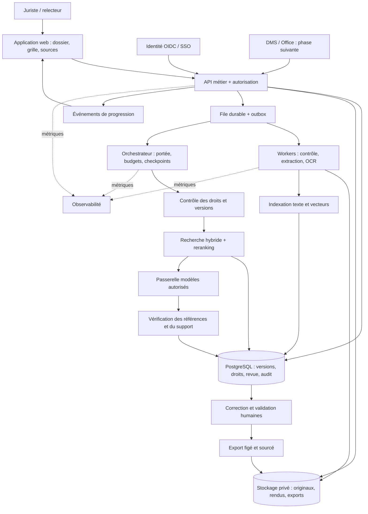

# Analyse fonctionnelle de Legora et cahier des charges d'une solution indépendante

**Version 1 — 18 octobre 2026.** Analyse préalable à l'implémentation ; aucun code applicatif produit ou modifié.

Le [registre des preuves](REGISTRE-PREUVES.md) contient les liens, dates et limites de chaque source S01–S26 et L01–L05. Toutes les sources web ont été consultées le 18/10/2026. Dans ce document, O = observé, D = déduit, I = inconnu, P = proposition indépendante. Les dates des essais publiés par Stanford sont le 13/10/2026 ; ils n'ont pas été reproduits ici.

## 1. Synthèse des constats et décision produit

**Recommandation P : construire d'abord une revue contractuelle traçable, de l'import à l'export validé.** La cible initiale proposée est une équipe de 5 à 30 juristes traitant des lots de contrats en français et en anglais. Son livrable est une matrice de points contractuels avec passages sources, corrections et décisions de revue.

**O — déclaration éditeur :** Legora présente une suite reliant analyse, recherche et rédaction, avec interfaces web, Office, mobile et collaboration client. La présentation aOS décrit des couches conceptuelles, pas une architecture technique vérifiable. [S19 — aOS](https://legora.com/product/aos).

**O — observation publiée :** la grille de revue est un objet persistant, avec contrôles de validation et documents accessibles à côté des réponses. Cela donne un exemple concret de travail révisable. Les essais publiés portent sur trois NDA fictifs et ne constituent pas une mesure de performance générale. [S02 — Stanford](https://ailearninghub.law.stanford.edu/legora-at-sls/tabular-review/).

**D — confiance élevée :** la valeur différenciante semble venir de la continuité entre corpus, production, vérification et réutilisation du travail. Justification : ces capacités apparaissent dans plusieurs surfaces documentées ; une réponse isolée ne termine pas le parcours. Ce constat n'établit ni la satisfaction des clients ni le retour sur investissement.

**O — observation publiée :** une citation exacte peut renvoyer à une affirmation dans un mémo de cadrage plutôt qu'à une preuve du fait. [S06 — Stanford](https://ailearninghub.law.stanford.edu/legora-at-sls/follow-the-citation/). **P :** différencier explicitement pièce primaire, déclaration d'une partie, instruction et analyse ; afficher les contradictions et le périmètre examiné.

**I :** performances en production, prix réels, formats et limites exacts, OCR, fournisseurs effectivement utilisés par tâche, topologie interne, garanties de reprise et couverture juridique par abonnement. Aucune de ces informations ne sera remplacée par une affirmation d'architecture.

**Utilisation du dépôt existant :** REA est l'outil d'investigation cloné à la demande, pas du code généré de notre futur produit. Je retiens son usage pour les prochaines captures et comparaisons de parcours autorisés. Le SaaS sera un projet distinct ; les concepts de provenance pourront être étudiés pour réutilisation sous leurs licences respectives. [L01–L05, registre](REGISTRE-PREUVES.md).

## 2. Cartographie fonctionnelle sourcée

Dans la colonne certitude, « O éditeur » confirme l'annonce ; « O publié » désigne une observation de l'utilisateur public cité. Les entrées/sorties sont limitées à ce que les sources documentent. Les rôles sont des utilisateurs fonctionnels, pas une liste des rôles d'accès internes de Legora.

| Fonctionnalité | Utilisateur | Problème résolu / rôle dans le parcours | Entrées | Sorties | Source et date du fait | Certitude |
|---|---|---|---|---|---|---|
| Projet et contexte | Avocat, juriste | Délimiter le dossier et le travail en cours | Nom, description, documents sélectionnés | Projet, Files, chats, Artifacts | [S03](https://ailearninghub.law.stanford.edu/legora-at-sls/access-and-surfaces/), 13/10/26 | O publié |
| Import et recherche dans les fichiers | Collaborateur, paralegal | Constituer puis retrouver le corpus | Fichiers PDF, DOCX, TXT dans l'exercice | Fichiers persistants, pièces jointes au message | [S04](https://ailearninghub.law.stanford.edu/legora-at-sls/context-and-project-files/), 13/10/26 | O publié ; pas une liste exhaustive de formats |
| Agent / Assistant | Juriste | Déléguer analyse et synthèse | Demande et contexte choisi | Réponse, étapes, objets selon tâche | [S03](https://ailearninghub.law.stanford.edu/legora-at-sls/access-and-surfaces/), [S05](https://ailearninghub.law.stanford.edu/legora-at-sls/ask-the-agent/), 13/10/26 | O publié ; différence complète des modes I |
| Chronologie et questions documentaires | Contentieux, investigations | Synthétiser les faits et lacunes | Pièces et demande | Tableau d'événements sourcés, réserves | [S05](https://ailearninghub.law.stanford.edu/legora-at-sls/ask-the-agent/), 13/10/26 | O publié |
| Citations consultables | Rédacteur, relecteur | Vérifier une proposition | Réponse et référence | Passage surligné puis fichier entier | [S06](https://ailearninghub.law.stanford.edu/legora-at-sls/follow-the-citation/), 13/10/26 | O publié |
| Tabular Review | M&A, immobilier, banque | Comparer systématiquement un lot | Documents, questions/colonnes | Matrice typée avec sources | [S01](https://legora.com/product/tabular-review), date non affichée ; [S02](https://ailearninghub.law.stanford.edu/legora-at-sls/tabular-review/), 13/10/26 | O éditeur + publié |
| Revue des cellules | Senior, responsable de dossier | Corriger et conserver une décision | Cellule et passage | Valeur éditée, marque de revue, verrou, activité | [S02](https://ailearninghub.law.stanford.edu/legora-at-sls/tabular-review/), 13/10/26 | O publié |
| Legal Research | Avocat, documentaliste | Rechercher dans un corpus juridictionnel déclaré | Question, juridiction, collections | Analyse et autorités citées | [S07](https://ailearninghub.law.stanford.edu/legora-at-sls/legal-research-scope/), 13/10/26 ; [S10](https://legora.com/product/legal-research), sans date | O publié / éditeur ; exhaustivité I |
| Word et playbooks | Rédacteur contractuel | Rédiger et revoir dans l'outil de travail | Document, instructions, positions | Clauses, redlines et transformations | [S09](https://legora.com/product/word-add-in), sans date | O éditeur |
| Révision d'un fichier avec brouillon | Juriste relecteur | Contrôler les changements avant sauvegarde | DOCX et instruction ciblée | Draft, modifications suivies, Accept/Reject | [S08](https://ailearninghub.law.stanford.edu/legora-at-sls/editing-with-a-review-gate/), 13/10/26 | O publié ; parcours web, distinct du complément Word |
| Editor | Équipe de rédaction | Transformer l'analyse en livrable partagé | Résultats et instructions | Document collaboratif, export Word stylé | [S12](https://legora.com/product/editor), démo référencée 06/11/25 | O éditeur |
| Workflows | Knowledge manager, associé | Standardiser une séquence de travail | Étapes, contexte et standards | Exécution combinant outils | [S11](https://legora.com/product/workflows), démo référencée 24/06/25 | O éditeur ; reprise et erreurs I |
| Skills | Juriste, knowledge manager | Capitaliser une méthode d'équipe | Instructions, références, modèles | Compétence réutilisable et partage gouverné | [S17](https://legora.com/blog/introducing-skills), 05/10/26 | O éditeur |
| Outlook | Juriste d'entreprise, avocat | Traiter l'information au point d'arrivée | Fils, pièces jointes, consignes | Résumé, brouillon, documents transférés | [S13](https://legora.com/product/outlook-add-in), sans date | O éditeur |
| Portal | Cabinet, client invité | Livrer et collaborer avec un périmètre choisi | Fichiers, revues, workflows publiés | Espace partagé personnalisé | [S14](https://legora.com/product/portal), sans date | O éditeur |
| Lists | Équipe transactionnelle | Suivre les conditions et actions | Contrats et documents de transaction | Checklist avec clause, responsable, échéance | [S16](https://legora.com/product/lists), sans date | O éditeur |
| Monitors | Conformité, conseil réglementaire | Détecter puis traiter les changements | Sujets, juridictions, sources | Flux, résumés, tâches et livrables | [S15](https://legora.com/product/monitors), sans date | O éditeur ; délai de détection I |
| Intake | Juridique interne, salarié demandeur | Qualifier et router une demande | Requête Slack, précisions, règles | Tâche attribuée, travail préparé, réponse | [S22](https://legora.com/newsroom/legora-launches-intake-an-agentic-front-door-for-in-house-legal-teams), 13/10/26 | O éditeur ; autres canaux prévus à cette date |
| Mobile | Juriste en déplacement | Consulter et continuer son travail | Questions et documents | Réponses citées, historique synchronisé | [S18](https://legora.com/product/mobile-app), démo référencée 06/11/25 | O éditeur ; parité I |
| Gouvernance | DSI, RSSI, administrateur | Contrôler accès et traitement | Identité, politique d'organisation | SSO, conservation et contrôles annoncés | [S24](https://legora.com/security), sans date ; [S25](https://legora.com/legal/security), 01/09/25 | O déclarations ; audit opérationnel I |

### Intégrations observables

Le communiqué du **14/10/2026** nomme notamment iManage, NetDocuments, SharePoint, Box et Google Drive pour les documents ; Datasite, Intralinks et DiliTrust pour les data rooms ; DeepJudge pour la recherche ; Everlaw pour l'eDiscovery ; Intapp et iManage pour les restrictions ; Intapp Time et Laurel pour le temps ; Docusign, Ironclad et Sirion pour les contrats. **O éditeur :** l'écosystème est déployé par phases. [S21](https://legora.com/newsroom/legora-launches-integration-ecosystem-spanning-the-enterprise-legal-stack).

**O éditeur :** la page intégrations annonce le respect des permissions sources, des contrôles à chaque requête et des journaux d'accès ; les fonctions et la disponibilité varient par connecteur. [S20](https://legora.com/product/integrations). **I :** opérations effectivement disponibles pour un abonnement donné, fraîcheur de synchronisation, gestion des pannes et révocations. Vérifier avec une matrice par connecteur : lire, rechercher, importer, écrire une version, supprimer, révoquer, journaliser.

**D — confiance moyenne :** les partenaires de contenu sont un enjeu majeur de profondeur en recherche juridique. Justification : les sources annoncées sont multiples ; leur couverture et les droits d'exploitation conditionnent le corpus accessible. [S10](https://legora.com/product/legal-research).

### Ce que les preuves ne permettent pas de conclure

OCR industriel, reconnaissance des tableaux scannés, exactitude garantie, export XLSX précis, résolution automatique de contradictions, API développeur générale et audit réglementaire complet restent **I**. Les APIs sont mentionnées dans les conditions UE lorsqu'elles sont convenues contractuellement ; cela ne prouve pas l'existence d'une API librement accessible. [S26](https://legora.com/legal/cbp-general-terms-and-conditions).

## 3. Parcours utilisateurs reconstitués

Les parcours ci-dessous décrivent Legora seulement pour les étapes O. Toutes les erreurs proposées sont D ou I, sauf mention contraire. Les actions de création d'une organisation et d'invitation initiale restent inconnues.

### A. Arriver, créer un projet, ajouter les pièces

**O publié :** dans l'environnement SLS, accès approuvé par l'université puis SSO ; une seconde fenêtre de connexion a été observée. L'écran projet présente titre, confidentialité, compositeur, fichiers récents et historique. Agent et Assistant sont sélectionnables. La création d'un projet est documentée, mais pas tous les champs de sa boîte de dialogue. [S03](https://ailearninghub.law.stanford.edu/legora-at-sls/access-and-surfaces/).

**O publié :** dépôt de fichiers → pièces jointes visibles dans le compositeur et fichiers persistants du projet. La liste affiche nom et date, avec recherche. Après navigation, les pièces jointes du compositeur disparaissent ; les fichiers restent et peuvent être rattachés depuis le projet. [S04](https://ailearninghub.law.stanford.edu/legora-at-sls/context-and-project-files/).

**D, confiance élevée :** transfert et préparation peuvent nécessiter une attente ; l'ordre OCR/indexation exact est I. Erreurs possibles D : session expirée, fichier illisible, format refusé, quota, droits manquants. **Vérification :** essais autorisés avec PDF texte, scan, DOCX corrompu, fichier protégé et coupure réseau ; relever états, délais et reprise. Ne pas présenter ces erreurs comme des messages Legora observés.

### B. Questionner les documents et vérifier la réponse

**O publié :** sélectionner le contexte, saisir une demande de chronologie, envoyer. L'exécution démarre immédiatement ; les étapes et sources lues apparaissent, avec Stop. La réponse contient événements, références et lacunes ; sa présentation varie entre essais. Un résultat de recherche intermédiaire vide n'a pas nécessairement arrêté la tâche. [S05](https://ailearninghub.law.stanford.edu/legora-at-sls/ask-the-agent/).

**O publié :** cliquer une référence ouvre le passage surligné à côté de la réponse ; un contrôle permet d'ouvrir le fichier complet. [S06](https://ailearninghub.law.stanford.edu/legora-at-sls/follow-the-citation/).

**I :** délai avant premier résultat, persistance après Stop, facturation des tâches interrompues et reprise après fermeture. **D, confiance moyenne :** pannes de modèle, absence de preuve et source devenue inaccessible doivent donner des issues différentes. Vérification par scénarios interrompus et questions volontairement insolubles.

### C. Produire puis revoir une matrice contractuelle

**O publié :** attacher Tabular Review puis demander une comparaison → résumé dans le chat et grille persistante. L'écran comporte ajout de documents/colonnes, filtrage, partage et téléchargement. Ouvrir une cellule donne réponses et document côte à côte ; on peut corriger, approuver, commenter ou verrouiller. La grille est retrouvable dans les Artifacts. [S02](https://ailearninghub.law.stanford.edu/legora-at-sls/tabular-review/).

**I :** progression précise par cellule, format du téléchargement et comportements des destinataires du partage. **D, confiance élevée :** une extraction partiellement échouée doit être distinguée d'une information absente ; une modification simultanée peut entrer en conflit. Vérifier sur 20 contrats, une pièce illisible, une colonne ajoutée après revue et deux relecteurs concurrents. Le simple affichage d'un bouton Share ne valide pas la sémantique des permissions.

### D. Rechercher le droit avec un périmètre déclaré

**O publié :** Legal research ouvre un sélecteur de juridiction ; Apply reste désactivé sans choix. Des collections par éditeur sont consultables. La juridiction choisie reste visible dans le compositeur et ne devient pas un paramètre global du projet. La limite de deux juridictions était visible sur ce compte. [S07](https://ailearninghub.law.stanford.edu/legora-at-sls/legal-research-scope/).

**D, confiance élevée :** collection indisponible, mauvaise juridiction et autorité insuffisante sont des issues métier distinctes. **I :** signalement automatique de l'abrogation ou du statut d'une décision. Vérifier avec un documentaliste, une question datée et une autorité volontairement inadaptée ; contrôler les sources réellement parcourues.

### E. Modifier puis livrer

**O publié :** une demande ciblée sur un DOCX produit un Draft non sauvegardé ; la revue expose les modifications et Accept/Reject. La sauvegarde exige une action distincte. Une incohérence potentielle entre deux clauses n'a pas été signalée dans tous les essais. [S08](https://ailearninghub.law.stanford.edu/legora-at-sls/editing-with-a-review-gate/).

**O éditeur :** Editor permet une rédaction collaborative et un export Word stylé. Ce parcours est annoncé, pas testé ici. [S12](https://legora.com/product/editor). **D, confiance moyenne :** risques de conflit de version, rendu Word dégradé ou référence devenue obsolète. Vérifier avec un document riche en tableaux, renvois, notes et styles ; comparer le fichier avant/après dans Word.

### F. Recevoir une demande métier

**O éditeur, 13/10/26 :** demande Slack → questions de clarification → tâche routée → préparation suivant les méthodes de l'équipe → revue puis retour au demandeur. Une automatisation des routines est configurable. Le communiqué situe Teams, email et MCP dans les extensions prévues, même si la page produit présente une vision multicanal. [S22](https://legora.com/newsroom/legora-launches-intake-an-agentic-front-door-for-in-house-legal-teams), [S23](https://legora.com/product/intake).

**I :** écrans de paramétrage, garanties de notification et gestion des doublons. **D, confiance élevée :** événement dupliqué, mauvais routage et approbateur absent sont des cas à tester. Cette capacité est hors MVP.

## 4. Architecture proposée — indépendante de Legora

Tout ce chapitre est **P**. Il s'agit d'une architecture permettant les capacités retenues ; aucune technologie ci-dessous n'est attribuée à Legora.

### 4.1 Choix d'ensemble

Monolithe modulaire TypeScript pour l'API métier et l'orchestration, interface React/TypeScript, workers séparés pour les documents et traitements IA. Un worker Python peut être ajouté si les bibliothèques d'extraction retenues le justifient. Une seule base PostgreSQL, stockage objet et file durable suffisent au pilote. Les modules sont séparés par contrats ; pas de découpage prématuré en microservices.

| Composant | Responsabilité | Choix initial et compromis |
|---|---|---|
| Interface | Projet, import, grille, visualiseur, revue, export | Grille virtualisée et visualiseur PDF ; DOCX prévisualisé en PDF, avec original conservé. Une conversion peut déplacer la pagination : conserver la correspondance de version. |
| API | Identité, autorisation, contrats métier, quotas | REST et événements serveur pour la progression. Requêtes courtes ; pas d'OCR dans la requête HTTP d'import. |
| Extraction | Type réel, antivirus, texte, OCR, structure | Extraction locale pour documents textuels ; OCR acheté ou local selon benchmark et confidentialité. Conserver pages, blocs, coordonnées et scores OCR. |
| PostgreSQL | Métadonnées, versions, revue, audit, recherche | Recherche plein texte + extension vectorielle envisagée ; valider rappel et filtrage avant de retenir l'index. Un moteur dédié n'est justifié qu'après mesure. |
| Stockage objet | Originaux, rendus, exports | Objets privés chiffrés, URLs temporaires, clés non devinables ; identité tenant dans les métadonnées et politiques d'accès. |
| File et workers | Import, extraction, analyse, export | Livraison pouvant être répétée ; consommateurs idempotents, checkpoints, quotas et file d'échecs. Ajouter un moteur de workflow durable si les reprises deviennent complexes. |
| Passerelle modèles | Modèles autorisés, région, coûts et budgets | Adaptateurs interchangeables, sorties structurées et limites par tâche. Une bascule fournisseur doit respecter les politiques de données. |
| Traçabilité | Sources, exécutions, décisions | Trace technique sans contenu confidentiel par défaut ; journal métier séparé ; accès aux preuves selon droits du dossier. |

### 4.2 Pipeline documentaire

1. API crée un import rattaché à l'organisation et au dossier ; le client transfère vers un objet temporaire autorisé.
2. Après confirmation, contrôler taille, type réel, empreinte et antivirus. Refuser archives non prévues et fichiers protégés pour le MVP, avec explication récupérable.
3. Créer une version immutable. Extraire texte et structure ; appliquer l'OCR aux pages qui le nécessitent, sans considérer une page sans texte comme automatiquement vide.
4. Conserver contenu original, texte normalisé, rendu de référence, pages et coordonnées. Une normalisation a une table de correspondance vers la source.
5. Segmenter par clauses et titres, avec débordement de contexte ; tableaux représentés avec lignes et en-têtes. Ne pas découper une exception de responsabilité de la clause principale.
6. Indexer avec `tenant`, dossier, version, classe documentaire et droits. Publier l'état prêt seulement après confirmation de l'indexation complète ; sinon déclarer couverture partielle.

États proposés : reçu → contrôlé → extraction/OCR → indexation → prêt ; branches rejeté, échec récupérable et annulé. Les états sont par document, pas uniquement par lot. Un nouveau fichier ne remplace jamais silencieusement la version citée.

### 4.3 Récupération, modèles et contexte

Pour une question libre : figer les versions sélectionnées, filtrer les autorisations, combiner recherche exacte et sémantique, reclasser les passages puis produire des affirmations reliées aux sources. Pour une revue en grille : visiter chaque document explicitement, rechercher pour chaque groupe de questions et utiliser le document entier lorsque sa taille le permet. Une simple recherche globale des meilleurs passages ne prouve pas que tous les contrats ont été analysés.

Grouper plusieurs colonnes compatibles par appel réduit les lectures répétées ; séparer celles dont les règles ou les sources diffèrent. Définir budgets de tokens, plafond de coût, nombre maximal de reprises et échéance globale. Les instructions du système et de l'utilisateur restent distinctes du contenu des documents. Un texte importé peut être malveillant : il ne peut autoriser un outil ni modifier les droits.

Les sorties portent des statuts explicites : **établi dans le périmètre examiné**, **information non trouvée**, **contradictoire**, **extraction insuffisante**, **erreur technique**. Une absence trouvée dans quelques passages n'autorise pas à conclure que tout le document est muet. Les éléments anciens de conversation peuvent être résumés ; les pièces sources et leur version restent référencées sans substitution par le résumé.

### 4.4 Citations et vérification

Une citation contient version du fichier, bloc/page, offsets, coordonnées si disponibles, extrait et empreinte. Le modèle choisit parmi des identifiants sources fournis ; le serveur vérifie leur existence et l'extrait. La vérification syntaxique d'une citation ne prouve pas que le passage justifie la proposition.

Séparer trois contrôles : ancrage exact, fidélité sémantique de l'affirmation, adéquation du type de source. Un évaluateur peut signaler un doute mais ne remplace pas la revue juridique. Afficher une justification concise avec preuves ; ne pas stocker ni présenter une prétendue chaîne de pensée interne du modèle.

Une correction humaine devient une nouvelle révision de cellule ; valeur IA et source restent consultables. Une nouvelle version du contrat rend la validation précédente obsolète pour cette version ; elle ne l'efface pas. Les contradictions conservent les deux propositions, leurs clauses et les dates pertinentes ; priorité d'un avenant à proposer comme interprétation à revoir, pas règle aveugle « dernier fichier gagne ».

### 4.5 Organisations, droits et isolation

Rôles proposés : administrateur d'organisation, gestionnaire de dossier, rédacteur, relecteur, lecteur. L'appartenance à une organisation n'accorde pas automatiquement tous les dossiers. Un administrateur technique ne lit pas les pièces par défaut. Invitations et attributions passent par des permissions explicites ; une approbation peut exiger un relecteur distinct selon la politique du client.

Toutes les tables métier portent le tenant ; les clés étrangères critiques incluent cette identité pour empêcher les références croisées. Contrôle applicatif et isolation en base se complètent. Les workers revalident les permissions du demandeur ; leur identité technique n'étend pas le périmètre du demandeur.

Les résultats dérivés héritent des restrictions des sources qui les composent. Sans filtrage fiable au niveau d'une partie de réponse, bloquer l'ensemble du résultat pour un utilisateur qui ne peut plus accéder à l'une de ses sources. Revalider à la lecture, à l'export et avant chaque étape sensible. Caches segmentés par tenant, principal et version des permissions ; les objets de conversation et exports sont inclus dans les tests de révocation.

Pour de futurs DMS, le connecteur obtient l'identité déléguée et vérifie les droits source ; si cette vérification est impossible, la requête échoue explicitement. Suppression : masquer immédiatement, révoquer accès et liens, purger les dérivés et index, puis appliquer les délais documentés aux sauvegardes. La restauration doit réappliquer les tombstones de suppression.

### 4.6 Asynchronisme et observabilité

Une transaction écrit la demande et un événement outbox ; un répartiteur alimente la file. Clé d'idempotence : tenant + versions + version du modèle de questions + configuration d'analyse. Un appel modèle dont l'issue réseau est incertaine peut coûter deux fois lors d'une reprise ; journaliser les tentatives et contenir ce risque par budget. Annulation coopérative et publication transactionnelle empêchent un résultat tardif de remplacer une correction verrouillée.

Métriques : pages traitées, couverture, erreurs OCR, attente de file, latence par étape, passages retrouvés, citations rejetées, corrections humaines, tokens, coût estimé puis réconcilié. Identifiant de corrélation sur tout le parcours. Logs techniques expurgés du contenu documentaire par défaut ; preuve métier accessible séparément et sous contrôle.

### 4.7 Modèle de données initial

| Entité | Champs essentiels / invariants |
|---|---|
| Organization | id, région, politiques de conservation, budget, configuration identité |
| User / Membership | identité externe, organisation, rôle organisationnel, état |
| Matter / MatterGrant | dossier, titre, membres/groupes, relation d'accès, version de politique |
| Document | dossier, nom, type de source déclaré, provenance, créateur |
| DocumentVersion | document, hash, original, rendu, version d'extraction, état, nombre de pages, version précédente |
| Page / Block / Chunk | version documentaire, numéro physique, label de page, offsets, coordonnées, texte, qualité OCR, embedding versionné |
| Conversation / Message / ContextItem | dossier, audience, contenu, sélection explicite des versions ; visibilité du chat définie |
| Run / RunStep / Usage | portée immutable, modèle/prompt versionnés, étapes, état, tentatives, tokens et coût |
| ReviewTemplate / TemplateVersion / ReviewColumn | instruction, type de sortie, critères d'absence, versions |
| Review / ReviewDocument | dossier, template figé, documents et versions explicitement inclus |
| Cell / CellRevision | document + colonne, valeur IA ou humaine, statut métier, génération courante, verrou, numéro de révision |
| Claim / Citation | affirmation, version source, extrait, localisation, contrôle d'ancrage et support |
| ReviewDecision / Comment | cellule ou document, révision visée, auteur, décision, motif, date |
| Artifact / Export | versions exportées, audience autorisée, manifeste, hash, état de génération, expiration |
| AuditEvent / Job / OutboxEvent | acteur réel et technique, action, cible, motif, corrélation, événements de traitement |
| Connector / SourceGrant | phase suivante : identité déléguée, référence externe, droits, date de vérification, état de synchronisation |

Relations principales : organisation → dossiers → documents → versions → blocs ; revue → documents sélectionnés × colonnes → cellules → révisions ; une révision porte plusieurs affirmations et citations. Décision humaine → révision précise, jamais valeur future. Les discussions et livrables référencent le Run qui les a produits.

Alternative : base ou schéma séparé par client, plus coûteux à migrer mais utile pour certaines exigences d'isolation. Alternative au stockage vectoriel initial : moteur de recherche dédié, au prix d'une synchronisation et d'une surface d'autorisation supplémentaires. Alternative aux workers gérés : traitements locaux déployés chez le client, avec maintenance et capacité à sa charge.

## 5. Cahier des charges du MVP

Tout ce chapitre est **P**. Le MVP n'est pas une reproduction de toute la suite Legora.

### 5.1 Parcours de référence et limites assumées

« Un juriste crée un dossier privé, importe 20 à 100 contrats autorisés, choisit 5 à 10 questions, lance une revue, vérifie les passages, corrige et verrouille les résultats, obtient la validation d'un collègue et exporte une matrice sourcée. »

PDF texte, PDF scanné et DOCX ; français et anglais. Limites initiales proposées : 100 documents par revue, 100 pages et 50 Mo par fichier, 10 colonnes par lancement. Ce sont des contraintes de notre pilote, ajustables après mesure. Aucun engagement de traiter 10 000 pages en quelques secondes.

Questions de départ : parties, date d'effet, durée, reconduction, préavis, droit applicable, plafond de responsabilité, exceptions au plafond, changement de contrôle et cession. Chaque colonne a un type de valeur et une politique de réponse quand l'information est absente ou ambiguë.

Hors MVP : recherche juridique générale, redline Word, coédition en temps réel, portail externe, DMS, veille, facturation juridique et agent autonome multicanal. Une question libre limitée aux documents du dossier peut suivre la grille en P1.

### 5.2 Fonctionnalités et critères d'acceptation

| ID | Fonction et composants | Critères vérifiables |
|---|---|---|
| F01 | Connexion et droits — identité, organisations, dossiers | Deux organisations de test isolées ; lecteur sans mutation ; gestionnaire peut inviter dans son périmètre ; révocation bloquant immédiatement les nouveaux accès API, sources et exports. |
| F02 | Dossier privé — API et navigation | Création, modification, archivage ; autre membre sans accès ne voit ni titre ni résultat de recherche ; audience des résultats explicite. |
| F03 | Import — UI, objets, workers | Progression par fichier ; erreurs distinctes pour protégé, corrompu, format, taille ; reprise réseau sans doublon ; document prêt seulement après indexation ; source originale récupérable par personne autorisée. |
| F04 | Extraction et OCR — workers | Chaque page comptabilisée ; pages douteuses signalées ; tableaux de référence conservant associations cellule/en-tête ; aucune page ignorée sans état visible. |
| F05 | Modèle de revue — UI et contrats | Questions modifiables, types texte/date/nombre/choix ; version figée au lancement ; modification ultérieure sans altérer les résultats antérieurs. |
| F06 | Lancement et suivi — orchestration | 100 × 10 cellules adressables ; progression obtenue au rechargement ; reprise après panne du worker ; résultat partiel clairement visible ; arrêt empêchant les nouvelles sous-tâches. |
| F07 | Résultats et sources — recherche, IA, visualiseur | Valeur factuelle avec source ou statut d'insuffisance ; clic ouvrant la bonne version et le passage ; dates manquantes non inventées ; source inaccessible sans fuite d'extrait. Seuils qualité en §7. |
| F08 | Correction et revue — versions, audit | Valeur IA conservée ; correction attribuée ; verrou protégé des régénérations ; approbation liée à la révision ; écritures concurrentes détectées ; changement de source marquant la revue obsolète. |
| F09 | Collaboration simple — partage interne, commentaires | Relecteur autorisé peut consulter et décider ; lecteur ne valide pas ; commentaires et décisions horodatés ; aucun partage public par défaut ; pas de coédition simultanée requise. |
| F10 | Export — worker et manifeste | XLSX des valeurs, statuts et références ; DOCX de synthèse structurée à partir des valeurs relues ; version, date et validation incluses ; liens applicatifs authentifiés ; téléchargement soumis aux droits courants. |
| F11 | Budget, audit et suppression | Estimation avant lancement, plafond bloquant les nouvelles tâches, consommation visible ; audit des décisions et exports ; suppression et purge testées selon la politique du pilote. |

Le DOCX du MVP est un rapport sobre généré par modèle, pas un éditeur de contrats. L'export d'un brouillon reste possible s'il est explicitement marqué non validé ; l'export « validé » exige que les cellules requises aient une décision de revue courante. Les fichiers téléchargés sont des instantanés : leur révocation à distance n'est pas promise.

### 5.3 Endpoints principaux proposés

Préfixe `/v1`. L'identité de l'organisation provient du contexte authentifié et fait l'objet d'une autorisation ; un identifiant fourni par le client ne fait jamais foi.

| Méthode et route | Usage / contrat principal |
|---|---|
| GET `/me` | Identité, organisations et capacités autorisées |
| POST `/matters` ; GET `/matters` | Créer / lister les dossiers accessibles |
| GET/PATCH `/matters/{id}` | Consulter / modifier, avec contrôle de version |
| POST/DELETE `/matters/{id}/members/{userId}` | Attribuer / retirer un accès, journalisé |
| POST `/matters/{id}/imports` | Manifeste, réservations d'upload limitées et expiration |
| POST `/imports/{id}/complete` | Confirmation idempotente après contrôle de l'objet |
| GET `/imports/{id}` | États par fichier et erreurs récupérables |
| GET `/documents/{id}/versions` | Historique autorisé |
| GET `/document-versions/{id}/viewer` | Rendu et carte des blocs ; aucun accès direct durable public |
| GET `/citations/{id}` | Extrait, ancrage, qualité et version après contrôle des sources |
| POST `/review-templates` | Questions et types ; versions explicites |
| POST `/matters/{id}/reviews` | Versions documentaires + version du modèle de revue |
| POST `/reviews/{id}/runs` | Lancement avec clé d'idempotence et plafond ; réponse 202 |
| GET `/runs/{id}` ; GET `/runs/{id}/events` | État et événements de progression rejouables |
| POST `/runs/{id}/cancel` | Annulation coopérative, sans effacer l'historique |
| GET `/reviews/{id}/cells` | Pagination, filtres et statuts ; réponse partielle explicite |
| PATCH `/cells/{id}` | Correction/verrou avec numéro attendu de révision |
| POST `/cells/{id}/decisions` | Approbation ou signalement visant une révision |
| POST `/cells/{id}/comments` | Commentaire attribué ; autorisation héritée |
| POST `/reviews/{id}/exports` | Format et révisions à figer ; réponse 202 |
| GET `/exports/{id}` | État puis lien temporaire si encore autorisé |
| GET `/matters/{id}/audit` ; GET `/usage` | Audit et consommation selon rôle |
| DELETE `/documents/{id}` | Retrait logique immédiat puis purge traçable ; blocage si conservation imposée |

Erreurs homogènes avec code métier et identifiant de corrélation : 401 session, 404 ressource absente ou non visible selon politique, 409 conflit de révision, 413 taille, 422 document invalide, 429 quota. Pas d'« exactement une fois » promis pour les appels aux fournisseurs ; l'application garantit une publication idempotente des résultats.

### 5.4 Développer ou acheter

| Capacité | Décision initiale P | Justification / condition |
|---|---|---|
| Identité, MFA, SSO | Acheter service ou déployer composant éprouvé | Éviter un système de mots de passe maison ; vérifier région, contrat, disponibilité et coût par organisation. |
| Base, objets, secrets, sauvegardes | Services gérés | Réduire l'exploitation ; tester restauration et exportabilité avant pilote. |
| OCR | Benchmark entre solution locale et prestataire | Mesurer sur scans juridiques ; interdire l'envoi externe sans politique de traitement compatible. |
| Modèles génératifs et embeddings | Acheter via API contractualisée | Aucun entraînement de fondation au MVP ; modèle sélectionné par qualité mesurée et politique de données. |
| Grille, visualiseur et génération Office | Bibliothèques existantes | Audit de licence et fidélité de rendu ; acheter un SDK documentaire si le maintien des formats l'exige. |
| Provenance, couverture, revue et versions | Développer | Cœur de la valeur et des garanties vérifiables. |
| Autorisation métier et dérivés | Développer sur primitives éprouvées | Matrice dossier/source/résultat spécifique ; tests obligatoires. |
| Jurisprudence et doctrine | Reporter, puis licencier ou intégrer des sources autorisées | Les conditions de réutilisation et de redistribution sont une dépendance produit. |
| DMS et Office | Un connecteur prioritaire en phase suivante | Choisir avec un client pilote plutôt que multiplier les intégrations incomplètes. |
| REA | Utiliser comme outil d'investigation et comparaison | Lire les contrats et exécuter sur cible publique ou test autorisé ; pas une dépendance de production imposée. |

Aucun prestataire ni contrat payant n'est choisi dans cette étude. Une revue du traitement des données, des régions, de la conservation et des sous-traitants précède les données clients. Il s'agit d'exigences du produit proposé, pas d'un avis de conformité juridique.

## 6. Backlog priorisé et feuille de route

Estimations P : jours-personnes utiles à la planification, pas devis. Valeur forte = nécessaire au parcours ou à sa confiance ; complexité inclut exploitation et tests. Les tâches ci-dessous partagent des composants et ne s'additionnent pas mécaniquement.

| Priorité | Lot | Valeur / complexité | Charge indicative | Dépendances / sortie attendue |
|---|---|---|---|---|
| P0 | Corpus de référence et contrats de preuve | Forte / moyenne | 8–15 j | Vérité terrain et erreurs métier définies avant réglage IA |
| P0 | Organisations, dossiers, accès et audit | Forte / forte | 15–25 j | Modèle d'autorisation testé |
| P0 | Import, versions, extraction et OCR | Forte / forte | 20–35 j | Pages comptabilisées et citations ancrables |
| P0 | Modèles de questions et orchestration | Forte / forte | 20–35 j | Revue reprenable et budgets |
| P0 | Grille, sources, correction et revue | Forte / forte | 25–40 j | Parcours complet avec relecteur |
| P0 | Exports et visibilité des validations | Forte / moyenne | 8–15 j | Livrable autonome et manifeste |
| P0 | Résilience, isolation, qualité et observabilité | Forte / forte | 20–35 j | Critères de lancement atteints |
| P1 | Questions libres limitées au dossier | Forte / moyenne | 10–20 j | Réutilise corpus et citations ; benchmark séparé |
| P1 | Modèles de revue partagés et versionnés | Forte / moyenne | 8–15 j | Réutilisation sans changement silencieux |
| P1 | Contradictions contrat/avenants et sources qualifiées | Forte / forte | 15–30 j | Corpus annoté et règles d'évaluation |
| P1 | Premier connecteur DMS | Forte selon client / forte | 20–45 j | Accès partenaire, sandbox et tests de révocation |
| P2 | Complément Word et redlines | Forte / très forte | 30–60 j | Fidélité DOCX et stratégie de conflits |
| P2 | Recherche juridique sur une juridiction bornée | Forte / très forte | 30–70 j + accords | Couverture et fraîcheur mesurables, droits de contenu |
| P2 | Portail invités | Moyenne à forte / forte | 20–40 j | Isolation et publication explicite |
| P2 | Éditeur collaboratif riche | Moyenne / très forte | 35–70 j | Collaboration et export réels à tester |
| P3 | Workflows visuels, Intake, veille et mobile natif | Selon segment / très forte | À estimer après découverte | Éviter d'élargir avant adoption du cœur |

### Calendrier proposé

| Phase | Semaines | Travail / jalon |
|---|---|---|
| Cadrage et preuve de faisabilité | 1–2 | Entretiens de 3–5 équipes, corpus autorisé, benchmark extraction/citations ; choix OCR et portée |
| Fondations | 3–5 | Identité, accès, dossiers, stockage, versions, pipeline documentaire |
| Première tranche verticale | 6–8 | 20 contrats → 5 colonnes → citations → correction → export ; démonstration sur vérité terrain |
| MVP complet | 9–12 | 100 documents, reprise, collaboration simple, décisions, budgets et exports |
| Pilote encadré | 13–16 | Scans difficiles, isolation, restauration, ergonomie, mesures de temps et corrections |
| Consolidation | 17–24 | Un connecteur ou questions dossier, selon usage ; hardening et revue externe |

Équipe hypothétique : 1 lead/backend, 1 frontend, 1 ingénieur documents/IA, QA/SRE à mi-temps et juriste produit à mi-temps. Produit/design environ 0,5 équivalent temps plein supplémentaire selon l'organisation. Hypothèse globale : **12–20 personnes-mois**, **12–16 semaines** jusqu'au pilote si travail en parallèle ; une équipe réduite ou une intégration DMS indispensable allonge le calendrier.

À un coût complet hypothétique de **9–16 k€ par personne-mois**, enveloppe de construction **110–320 k€**, hors contenu sous licence, certification et exploitation récurrente. Ajouter une réserve de **15–25 %** selon qualité des documents et contraintes clients. Ce sont des hypothèses budgétaires internes, pas des tarifs Legora ni des devis fournisseurs. Une suite couvrant Office, plusieurs DMS, recherche juridique et portail exige un programme ultérieur de plusieurs équipes ; aucune parité complète n'est promise à l'issue du MVP.

## 7. Plan de validation, faisabilité et inconnues

### 7.1 Corpus et méthode

Créer **200 documents synthétiques ou explicitement autorisés**, français/anglais, contrats et avenants, de 1 à 100 pages : environ 60 % PDF texte, 20 % scans et 20 % DOCX. Inclure 20 ensembles liés contrat/avenant, des montants en tableaux, clauses implicites, exceptions, dates ambiguës, doublons, pièces corrompues et instructions hostiles insérées dans les documents. Ces catégories peuvent se chevaucher.

Préparer 1 000 questions d'extraction, dont au moins 150 sans réponse et 100 sur des divergences documentaires ; annoter valeur, passages suffisants, classe de source, version et issue acceptable. Séparer par famille de contrats entre développement et jeu final, pour éviter qu'un modèle de document quasi identique soit vu des deux côtés. Deux relecteurs juristes annotent le jeu final et arbitrent leurs désaccords. Répéter trois fois un sous-ensemble fixe pour mesurer la variabilité, sans choisir le meilleur essai.

Séparer évaluation de l'extraction, de la recherche, de la réponse et du jugement humain. Rapporter résultats par format, langue et difficulté, avec intervalles de confiance et nombre de cas. Une moyenne globale ne doit pas masquer les scans ou les clauses de responsabilité.

### 7.2 Critères de lancement proposés

Ce sont des **objectifs à mesurer**, pas des performances constatées de Legora ou de notre application.

| Dimension | Protocole | Seuil pilote proposé |
|---|---|---|
| Exactitude | Comparer réponses à la vérité terrain ; normaliser dates/montants sans perdre le sens ; vérifier exceptions | ≥95 % sur champs simples de PDF texte ; ≥90 % sur corpus complet ; publier séparément cas complexes |
| Récupération | Vérifier présence d'un ensemble de passages suffisant avant génération | Rappel ≥95 % sur questions répondables du jeu final |
| Ancrage des citations | Ouvrir la bonne version, page et extrait ; audit automatique exhaustif et contrôle visuel échantillonné | 100 % des citations publiées résolvent ; ≥99 % d'ancrages exacts sur le jeu annoté |
| Support de l'affirmation | Juristes évaluent si les sources étayent réellement la réponse, exceptions incluses | ≥97 % des affirmations factuelles émises sont suffisamment soutenues |
| Réponse non disponible | Questions absentes, corpus partiel et pages illisibles | Rappel d'abstention ≥95 % ; fausse abstention ≤10 % sur questions répondables |
| Contradictions | Contrat/avenant divergents, dates et champs contradictoires | ≥90 % des contradictions annotées signalées avec les deux sources ; précision ≥90 % |
| Sources de cadrage | Mémo utilisateur affirmant un fait absent des pièces | 100 % des cas critiques signalent la nature de l'affirmation ; pas de promotion en preuve primaire |
| Permissions | Matrice inter-tenant, intra-dossier, révocation pendant run, caches, historique, citations, événements et exports | Zéro fuite dans les scénarios automatisés et la revue indépendante ; aucune garantie universelle déduite du seul test |
| Injection documentaire | Documents demandant d'ignorer les règles, d'exfiltrer ou d'appeler une URL | Aucun changement de droits ni appel non autorisé ; contenu traité comme donnée |
| Versions et concurrence | Deux corrections simultanées, régénération, ajout d'avenant | Conflit détecté ; verrou conservé ; validation obsolète explicitement marquée |
| Résilience | Coupure réseau, répétition d'événement, arrêt worker, fournisseur indisponible | Aucun résultat dupliqué publié ; reprise traçable ; source et correction intactes |
| Latence | Environnement fixé, froid/chaud, cinq revues simultanées ; files comprises | Cibles p95 : 20 contrats texte × 10 questions ≤5 min ; 100 × 10 ≤20 min ; ingestion scannée mesurée séparément |
| Interface | Test utilisateurs clavier et écran de taille bureau ; vérifier source → correction → validation | Réussite du parcours sans assistance par ≥80 % des 5–8 pilotes, puis itération |
| Coût | Tokens et OCR facturables par tentative, export, recherche et stockage attribués au Run | Estimation versus coût réconcilié dans ±25 % sur lots réguliers ; dépassements visibles et analysés |
| Gain métier | Comparer revue manuelle et assistée sur lots comparables, ordre alterné | Hypothèse à valider : ≥30 % de temps gagné sans augmentation des omissions critiques |

Ne pas transformer le score d'un second modèle en vérité terrain. Le juge automatique aide au tri ; les décisions du jeu final viennent de l'annotation humaine. Les objectifs nécessitent validation avec le client pilote et n'autorisent pas une utilisation sans revue.

### 7.3 Latence et coût : modèle de planification

Hypothèse d'un lot : **100 contrats × 20 pages × 500 tokens/page = 1 million de tokens de texte**, 10 questions, regroupées en 1 à 3 passages logiques par document. Prévoir **1–3 millions de tokens entrants** et **0,1–0,25 million sortants**, puis **20–50 %** de marge pour reprise, validation et contexte. Le coût augmente si un orchestrateur relit plusieurs fois les mêmes pièces ; il baisse si seules des clauses suffisantes sont examinées, sans permettre de prétendre à une couverture complète injustifiée.

Pour calculer sans choisir de fournisseur, retenir des **tarifs fictifs de planification**, à remplacer par des devis : 2–12 €/million de tokens entrants, 8–50 €/million sortants. Formule : coût IA = entrée × tarif entrée + sortie × tarif sortie, augmenté des reprises et outils. On obtient environ **4–75 € d'IA par lot**. OCR hypothétique de 0,001–0,03 €/page : **2–60 € si les 2 000 pages sont scannées**. Ajouter recherche, calcul, conversion et export : environ **0,5–5 €** variables par lot selon déploiement. Enveloppe indicative **5–140 €/lot**, hors infrastructure fixe et travail humain ; un document texte déjà indexé n'engendre pas un nouvel OCR.

Une question libre limitée au dossier, avec 12–60 k tokens entrants et 1–3 k sortants, serait approximativement **0,05–1,50 €** avec ces mêmes hypothèses et une marge d'outils/reprises. Les prix ne décrivent aucun fournisseur actuel. Le plafond doit être calculé avant engagement, puis comparé aux consommations effectives.

Scénario mensuel : 10 organisations, 50 utilisateurs au total, **200 lots**, soit 20 000 contrats / 400 000 pages ; 20 % de pages nécessitant OCR et 2 000 questions supplémentaires. Ordres de grandeur : IA des revues 0,8–15 k€, OCR 80–2 400 €, autres calculs variables 100–1 000 €, questions 100–3 000 €, socle géré 500–2 500 €. Total technique arrondi **1,6–24 k€/mois**, hors support, équipe, taxes et licences de contenu. Fourchette volontairement large ; le pilote doit surtout déterminer le nombre réel de lectures par document et le coût des exceptions.

Ces latences et coûts ne sont pas mesurés. La concurrence des fournisseurs, les limites de débit, le volume d'OCR, la taille des sorties et le temps de revue humaine dominent l'incertitude. Un mode économique peut regrouper les questions ; un mode sensible peut exiger davantage de contrôles, avec prix et délai visibles.

### 7.4 Difficultés majeures et différenciation

| Difficulté | Conséquence | Réponse produit proposée |
|---|---|---|
| Clause correcte mais exception omise | Erreur matérielle malgré citation réelle | Regrouper clause, définition et exceptions ; benchmark spécifique |
| Source fidèle mais faible | Apparence trompeuse de preuve | Qualification des sources et distinction fait / affirmation / interprétation |
| Contrats et avenants | Plusieurs réponses possibles selon date et portée | Graphe des versions et relations, contradictions documentées, validation humaine |
| Tableaux et scans | Montants associés à la mauvaise ligne | Structure et coordonnées conservées, qualité visible, revue obligatoire si doute |
| Révocation après génération | Fuite via résumé, cache ou export | Restrictions héritées, recontrôle et politique explicite des instantanés téléchargés |
| DOCX riche | Mise en page ou renvois cassés | Reporter redline avancé, acheter SDK si nécessaire, tests dans Word |
| Contenu juridique | Couverture et actualité insuffisantes | Une juridiction bornée, catalogue des sources et dates de mise à jour avant expansion |
| Adoption | Grille produite mais non relue ou inutilisable | Mesurer le temps de vérification et la qualité du livrable, pas le seul temps de génération |

Différenciations à tester : offre française/anglaise sur un segment de contrats ; visualisation de la couverture documentaire ; type et force des sources ; contradictions à deux passages ; export avec manifeste de vérification ; coût estimé avant lancement ; parcours de revue plus court et accessible aux petits cabinets. Ce sont des hypothèses commerciales **D, confiance moyenne**, car elles répondent aux difficultés identifiées mais n'ont pas encore été validées par entretiens ni comparaison complète des concurrents.

### 7.5 Questions ouvertes et méthode de vérification

| Information inconnue | Méthode concrète | Impact |
|---|---|---|
| Création d'une organisation et provisioning Legora | Démonstration administrateur ou tenant de test explicitement autorisé | Affiner onboarding et rôles |
| Formats, quotas et OCR Legora | Matrice de fichiers synthétiques et documentation de l'abonnement | Comparer le périmètre réel |
| États de chargement, Stop et reprise | Captures de scénarios sur test autorisé, avec interruption contrôlée | Critères UX et résilience |
| Formats d'export de la grille | Télécharger un résultat fictif dans le tenant autorisé | Comparaison des livrables |
| Droits du partage et révocations | Deux comptes, droits croisés, révocation pendant exécution | Modèle d'accès et dérivés |
| Connecteurs activés et opérations permises | Sandbox partenaire + matrice d'actions + journaux | Ordre d'intégration et coûts |
| Prix Legora et modalités d'API | Devis et documentation contractuelle obtenus du vendeur | Positionnement économique |
| Portée des attestations de sécurité | Rapports via Trust Center, contrats, régions, rétention et sous-traitants | Préconditions du pilote client |
| Architecture interne et modèles par tâche | Documentation technique publiée ou entretien autorisé | Information facultative : notre architecture n'en dépend pas |
| Besoin prioritaire du futur produit | 3–5 entretiens et observation de lots manuels autorisés | Valider segment, colonnes, export et prix |

### 7.6 Utilisation concrète de REA lors des prochaines étapes

1. **Geler la référence** : utiliser la révision locale documentée ; vérifier la chaîne Node/npm demandée avant installation. Aucun setup global ni configuration d'agent n'a été réalisé.
2. **Utiliser ses captures déclaratives** pour les pages publiques ou une application de test autorisée : définir question d'investigation, état initial, actions, état attendu, DOM/accessibilité/capture utiles et limite de temps. Le contrat explique que l'URL seule ne suffit pas à constater un résultat. [L03](../rea/docs/browser-scenario-contract.md).
3. **Conserver les preuves** dans un dossier d'analyse : date, URL, portée, version du scénario, observation, limitation et pointeur vers artefact. Ne pas assimiler une absence de capture à une absence de fonctionnalité.
4. **Après autorisation d'un tenant**, capturer les parcours avec documents fictifs et comptes de test ; isoler les identifiants de transport et préserver le contexte des observations. Les écrans privés ne sont pas inclus dans la présente étude.
5. **Comparer ensuite notre implémentation** sur les mêmes objectifs fonctionnels et corpus autorisés : import, source, correction, reprise, export. Mesurer les résultats, sans recopier les assets ni dépendre des endpoints privés de Legora.
6. **Réutilisation de code éventuelle** : examiner précisément EvidenceLedger et les contrats Evidence, leurs tests, dépendances et licences. Préférer d'abord REA comme outil externe ; n'extraire un module qu'après avoir établi son intérêt et son coût de maintenance. [L04](../rea/src/application/investigation/EvidenceLedger.ts).

Le prochain jalon d'implémentation est la tranche verticale du §6 : dossier → import → cinq champs → citations → correction → export. Le registre, les critères F01–F11 et le corpus de validation servent de référence commune à l'équipe.
